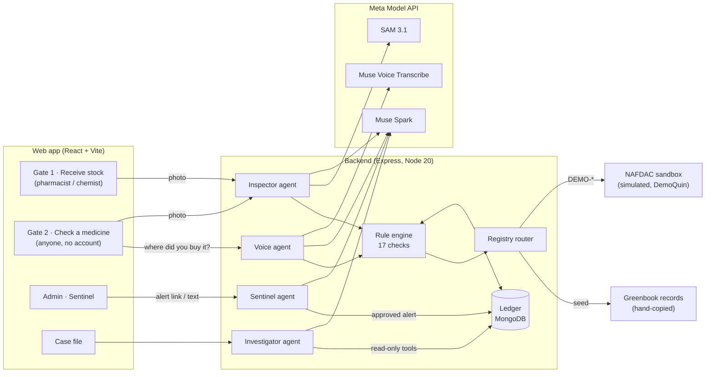

# TrueMed architecture

## Overview

Meta keys live only on the backend. Every Meta call goes through one wrapper (`backend/src/services/meta.js`) with a timeout, one retry, a cost log and a daily call/spend cap.

## One scan, step by step (Inspector)

1. **Quality gate** (sharp): blur, darkness, size. Bad photos get a retake message, not a guess.
2. **In parallel:**
   - **Muse Spark** reads the label into strict JSON (`agents/inspector/schemas.js`): brand, NAFDAC no., batch, dates, per-field confidence, and a box around the date block.
   - **SAM 3.1** segments `barcode`, `label` and `seal` (noun-phrase prompts, one per request).
   - **zxing-wasm** decodes the GS1 DataMatrix: GTIN (01), batch (10), expiry (17), serial (21), check digit.
3. **SAM 3.1 box prompt** on Muse Spark's date box outlines the date block; **Muse Spark** examines that crop for overprinting, stickers and mismatched fonts.
4. **Confirm step:** if a hard check would fail on text the AI read, the user sees the values in large type and confirms or corrects them before any High-risk verdict.
5. **Rule engine** scores; **Muse Spark** explains the verdict in the chosen language using only the evidence list.

## Rule engine

One file per check in `backend/src/rules/checks/`, each returning `{ id, status: pass|fail|skipped, type, reason, evidenceRegion?, source? }`.

| Type | Checks | Can produce |
|---|---|---|
| Hard | `REG_NOT_FOUND`, `REG_PRODUCT_MISMATCH`, `ALERT_MATCH`, `EXPIRED`, `SHELF_LIFE_IMPLAUSIBLE`, `GS1_INVALID`, `BARCODE_PRINT_MISMATCH`, `SERIAL_CLONE`, `WRONG_SHOP`, `ALREADY_SOLD_ELSEWHERE`, `SERIAL_NEVER_ISSUED` | High risk |
| Soft (AI judgement) | `ARTWORK_DIFFERENCE`, `TAMPER_SIGNS`, `LOOKALIKE_NAME`, `BATCH_SHOP_MISMATCH`, `REPEAT_NEARBY` | Caution at most |
| Info | `EXPIRING_SOON` | Note |

Scoring: any hard fail → **High risk**; else any soft fail → **Caution**; key fields unreadable → **Can't verify**; custody known and shop confirmed → **Genuine: authorized chain** / **Checked: open-market source**; otherwise **No red flags** or **No record** ("This does not mean it's fake").

Rules that keep it honest:
- Unreadable input is `skipped`, never `pass`.
- `REG_NOT_FOUND` fails only on an explicit "not registered" answer from a registry; a timeout or an unreachable source is `skipped`.
- A shop the AI matched from speech counts only after the user confirms it; unconfirmed matches cap at Caution.
- No location consent → location checks are `skipped`.

## The ledger

MongoDB collections: `packs` (one per unit serial: shop, source, status), append-only `scanEvents`, `issuedSerials` (DemoQuin's maker list), `alerts`, `shops`, `caseFiles`, `notifications`, `scanSessions` (kept 14 days).

- **Gate 1 receiving** upserts the pack to the shop (`in_stock`) and logs the event. A serial already held by another shop → `SERIAL_CLONE`, rejected, both shops notified.
- **Gate 2 home** asks where the pack was bought *before* revealing its shop, then compares. The first verifier claims the pack.
- **Reconciliation** per shop (received vs verified) feeds the Investigator.

## Agents

- **Voice:** recorded answer → ffmpeg → 24 kHz PCM → Muse Voice Transcribe (WebSocket) → Muse Spark matches the rough transcript to a shop (fuzzy name + area) → user confirms.
- **Sentinel:** NAFDAC alert URL or text → Muse Spark with web search → zod-validated alert record → **human approves** → matching packs found → shops notified.
- **Investigator:** Muse Spark with tool calling, capped at about 8 steps, over read-only tools: `getPackHistory`, `getShop`, `getShopReconciliation`, `findAlerts`, `getScansForBatch`, `getProduct`. It streams each tool call to the UI and writes a case file with a draft report. It never sends anything; the user does.

## NAFDAC registry layer

`backend/src/registry/` routes "is this number registered?" to whoever can answer honestly: the **simulated NAFDAC sandbox** for `DEMO-*` numbers, hand-copied Greenbook records, a real NAFDAC API if `NAFDAC_API_URL` is ever set, or an optional cached Greenbook lookup. Research and the sandbox contract: [NAFDAC_INTEGRATION.md](NAFDAC_INTEGRATION.md).

## Stack

React 18 + Vite + Tailwind + TanStack Query (web) · Express + Mongoose + zod + sharp + zxing-wasm + bwip-js + fluent-ffmpeg + ws + `@meta-sam/parser` (backend) · `openai` SDK pointed at `https://api.meta.ai/v1` · Vitest. Hosted demo: Vercel (web), Node + PM2 + Nginx on a VPS (API), MongoDB, ImageKit (private media, signed URLs).
